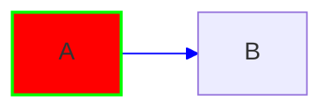

# Viewer/editor del workspace

Questa guida descrive il pannello workspace dopo l'aggiornamento: non è più
solo un'anteprima, ma un editor bidirezionale fra sorgente Mermaid e SVG.

## Layout

- Il **chevron in alto a sinistra** nella testata del workspace espande il
  viewer a tutta finestra: chat e cronologia si ritirano e resta una barra
  verticale con il chevron per riaprirle.
- I controlli sono nella **fascia verticale a destra del diagramma**, con le
  tab `Elemento`, `Tema`, `Versioni` e `Sorgente`. La fascia si chiude con il
  chevron `PanelRightClose` e si riapre dalla barra verticale `Controlli`.
- Quando la finestra è stretta la fascia si restringe (max 60% del workspace);
  chiudendola il diagramma recupera tutto lo spazio.

## Navigazione e strumenti

La toolbar ha due strumenti:

- **Freccia** (`MousePointer2`, scorciatoia `V`): modalità selezione oggetti.
  Clicca un nodo, un arco o un gruppo per selezionarlo; trascina sullo sfondo
  per spostare la vista. È la modalità predefinita.
- **Mano** (`Hand`, scorciatoia `H`): modalità pan. Trascina ovunque per
  spostare la vista senza selezionare gli elementi.

- **Rotella**: zoom centrato sul puntatore.
- **Shift + rotella**: pan orizzontale.
- **Pinch** (touch/trackpad): zoom e pan.
- **Doppio click su un nodo** (modalità selezione): modifica dell'etichetta
  inline.
- **F** (stage focalizzato): adatta il diagramma.
- **0**: dimensione reale.
- **+ / −**: zoom.
- **Frecce**: pan da tastiera.
- **Ctrl/Cmd + S**: salva una versione.
- **Esc**: annulla la modalità connetti o l'editor etichetta.
- **Delete**: elimina l'elemento selezionato (con conferma).

I pulsanti in basso a destra nello stage e nella toolbar fanno le stesse cose.

## Tema

La tab **Tema** contiene:

- preset rapidi: `Auto` (segue il tema dell'app), `Chiaro`, `Scuro`,
  `Contrasto`, `Daltonici` (Okabe-Ito), `Neon`, `Blueprint`, `Sunset`,
  `Carta`, `Terminal`, `Candy`, `Mono`, `Oceano`;
- colori del canvas, testo, testo attenuato, linee, superficie dei box,
  superficie alternativa, bordo e accento;
- font, spessore e tratteggio predefiniti, raggio e dimensione label;
- colore e griglia dell'**area di lavoro** attorno al diagramma.

Il tema è **per diagramma** e viene salvato nelle impostazioni
(`diagram_themes`). Non è versionato e non viene incluso nel `.mmd`: gli export
SVG/PNG invece lo includono. Il tema `Auto` segue il tema dell'app; un tema
personalizzato resta invariato quando cambi tema all'app.

La chat può comandare preset e palette del diagramma selezionato. Il modello
riceve il tema corrente e, se richiesto, restituisce un blocco separato:

```mc-theme
{"preset":"terminal"}
```

oppure una modifica parziale della palette:

```mc-theme
{"preset":"custom","tokens":{"bg":"#000000","fg":"#ffee00","accent":"#ff00ff"}}
```

L'app applica il tema, nasconde il blocco dalla trascrizione e mostra un
avviso. I token non citati restano quelli correnti. Il blocco non viene salvato
nel `.mmd` né nel sorgente del diagramma.

Il parser accetta sia JSON sia la forma semplice `preset: nome` (utile perché
alcuni modelli scrivono YAML invece di JSON). Se il blocco non è interpretabile,
la chat lo segnala e non applica nulla, invece di lasciare il tema precedente
senza spiegazione. Quando è presente un preset, i token uguali a quelli già in
uso vengono ignorati: un cambio preset non viene sovrascritto dalla palette
precedente rimandata indietro dal modello.

## Elementi

La tab **Elemento** permette di:

- selezionare un nodo, un arco o un gruppo dal canvas (Shift per selezione
  multipla) o dall'elenco;
- modificare riempimento, cornice, spessore, tratteggio, colore testo,
  opacità, raggio, font e grassetto;
- applicare lo stile a tutti i nodi o a tutti gli archi;
- per gli archi di un **flowchart**, scegliere il tipo di punta (freccia
  singola o doppia, cerchio, croce, nessuna punta, tratteggiata, spessa) e
  invertire gli estremi con **Inverti**, così la punta singola passa da
  destra a sinistra;
- ripristinare un elemento;
- vedere i rapporti di contrasto e correggere il testo con bianco/nero o con
  il preset `Contrasto`. Le soglie pratiche sono: testo 4.5:1; bordo/fill e
  box/sfondo segnalati sotto 1.2:1, così i temi decorativi non producono
  falsi allarmi ma il caso "box quasi uguale al fondo" viene rilevato.

Per i flowchart si possono anche cambiare forma, aggiungere nodi, connettere
nodi ed eliminare elementi. L'eliminazione lavora per righe: se un nodo è in
una catena, vengono rimosse le righe che lo contengono (la UI lo conferma
prima).

La **direzione del layout** è modificabile dalla toolbar per flowchart, class,
state ed ER. Le opzioni sono `Verticale ↓` (TB), `Verticale ↑` (BT),
`Orizzontale →` (LR) e `Orizzontale ←` (RL). Nei flowchart la direzione vive
nell'intestazione (`flowchart LR` / `graph LR`); negli altri tipi viene scritta
come direttiva `direction LR` subito dopo l'intestazione, sostituendo quella
eventuale. `TD` è accettato in lettura come alias di `TB`.

Per **class** ed **ER** le linee di relazione sono selezionabili e eliminabili
con lo stesso meccanismo, anche se non ne è supportato lo stile per-arco.

Le punte si modificano solo nei **flowchart**, perché Mermaid codifica il tipo
di freccia nella sintassi della connessione. Gli state diagram accettano solo
`-->`; class ed ER usano simboli di relazione diversi (ereditarietà,
composizione, cardinalità) e restano modificabili dal sorgente. La modifica
delle punte preserva etichette, forme dei nodi e le altre connessioni della
stessa riga; se una riga non è interpretabile, il controllo viene disabilitato
con una spiegazione.

### Tipi supportati per lo stile per elemento

Mermaid non consente gli stessi stili su tutti i tipi. La UI abilita solo ciò
che il renderer accetta:

| Tipo | Nodi | Archi | Gruppi |
|---|---|---|---|
| flowchart | sì | sì (stile + selezione) | sì |
| class | sì | selezione sì, stile no | — |
| state | sì | sì (stile + selezione) | — |
| er | sì | selezione sì, stile no | — |
| sequence, pie, gantt, timeline, journey, quadrant, xychart, sankey, mindmap | no | no | no |

Per i tipi senza stile per elemento resta la palette globale. I controlli non
disponibili sono disabilitati con una spiegazione. Il testo delle etichette
degli archi non è stilizzabile separatamente: `linkStyle` controlla la linea,
non il label (limite di Mermaid).

Nel caso di **class** ed **ER** le relazioni non hanno uno stile per-arco
affidabile in Mermaid, ma sono comunque selezionabili dal canvas o dall'elenco
`Archi`: puoi ispezionarle, andare alla riga sorgente ed eliminarle. I controlli
di colore/spessore/tratteggio restano disattivati con la spiegazione nel
pannello.

## Sorgente e bidirezionalità

La tab **Sorgente** mostra il testo Mermaid con numeri di riga, stato
riga/colonna e salvataggio con Ctrl/Cmd+S.

- Selezionando un elemento e premendo l'occhio nell'inspector, il cursore va
  alla riga corrispondente.
- Spostando il cursore nel sorgente, se il token è un id noto, l'elemento
  viene selezionato nel diagramma.
- Le modifiche al sorgente aggiornano l'SVG; le modifiche visuali di stile,
  etichetta, forma, direzione, nodi e archi aggiornano il sorgente.
- Prima di applicare una modifica visuale il sorgente viene validato con
  Pele; se la modifica rompe il rendering viene rifiutata.

Gli stili per elemento vengono scritti in un blocco generato in coda al
sorgente:



Il blocco è sintassi Mermaid valida (commenti + `style`/`linkStyle`) e viaggia
con versioni, ripristino ed export `.mmd`. Gli `style`, i `linkStyle` e i
`classDef`/`class` scritti a mano vengono letti e rispettati; l'ispettore mostra
lo stile effettivamente renderizzato. Al primo edit di un elemento, lo stile
efficace viene materializzato nel blocco, che essendo in coda vince.

## Versioni, AI ed export

- **Salva versione** crea una versione solo se il sorgente cambia.
- Il ripristino riporta il sorgente e gli stili della versione scelta; il tema
  per diagramma resta quello corrente.
- Se ci sono modifiche non salvate, l'invio all'AI con quel diagramma come
  target viene bloccato: salva prima.
- Se il diagramma cambia durante lo streaming, l'aggiornamento AI non viene
  applicato automaticamente; viene mostrato un avviso.
- Altrimenti, gli stili dei nodi/gruppi rimasti vengono riapplicati per id;
  gli stili degli archi si conservano solo se la lista archi è identica.
  Gli stili di elementi scomparsi vengono scartati e segnalati.
- L'export è sempre fatto su un render fresco del sorgente corrente:
  SVG con/senza sfondo, PNG 1x/2x/3x, `.mmd`, copia SVG/sorgente.
- L'SVG esportato **materializza i colori del tema**: sostituisce le variabili
  CSS di Pele con valori concreti (fill, stroke, testo, sfondo). Così si apre
  con gli oggetti visibili anche in viewer o convertitori che non applicano i
  fogli di stile interni all'SVG.

## Limiti dichiarati

- Il layout è automatico di Mermaid: non si trascinano i nodi in posizioni
  libere, perché la posizione non è rappresentabile nel sorgente.
- Il tema per diagramma non è versionato e non è incluso nel `.mmd`.
- L'editing strutturale visuale è limitato ai flowchart.
- Sequence, pie, gantt, timeline, journey, quadrant, xychart, sankey e mindmap
  non hanno stile per elemento; solo palette globale. Il testo delle etichette
  degli archi non ha uno stile separato.
- I diagrammi `block` non hanno ancora l'ispettore per elemento.
- Un renderer Mermaid esterno non conosce il tema dell'app (variabili CSS
  Pele/settings): gli stili nativi sì, la palette no.
- L'editor di codice è un textarea potenziato; syntax highlighting e ricerca
  in-editor sono nel backlog.
